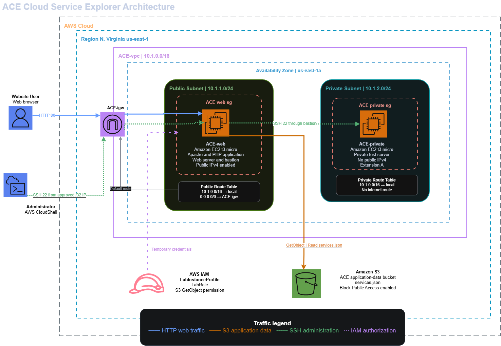
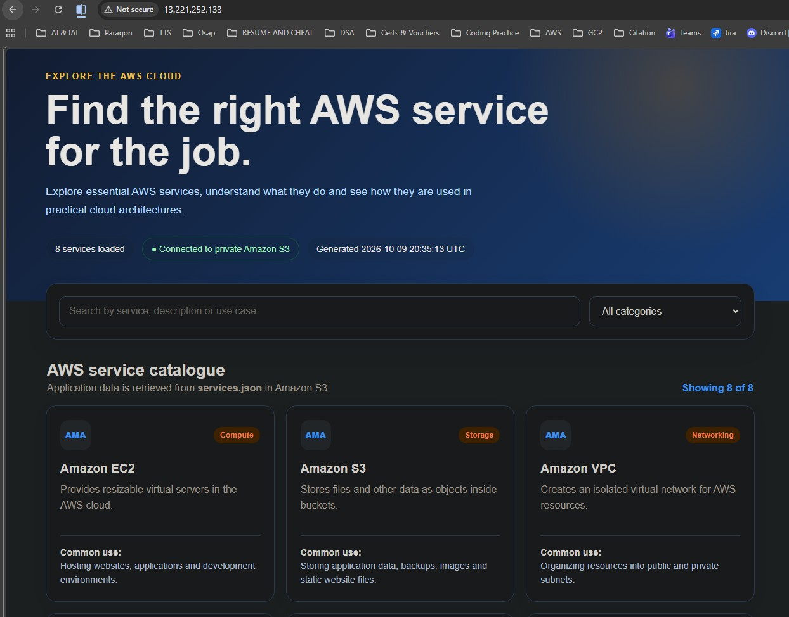
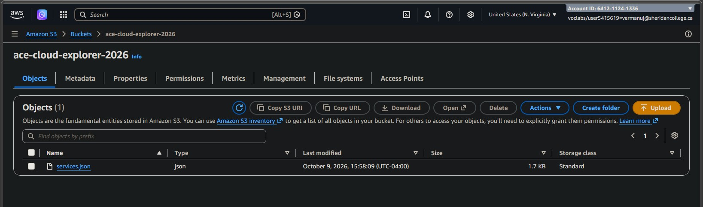
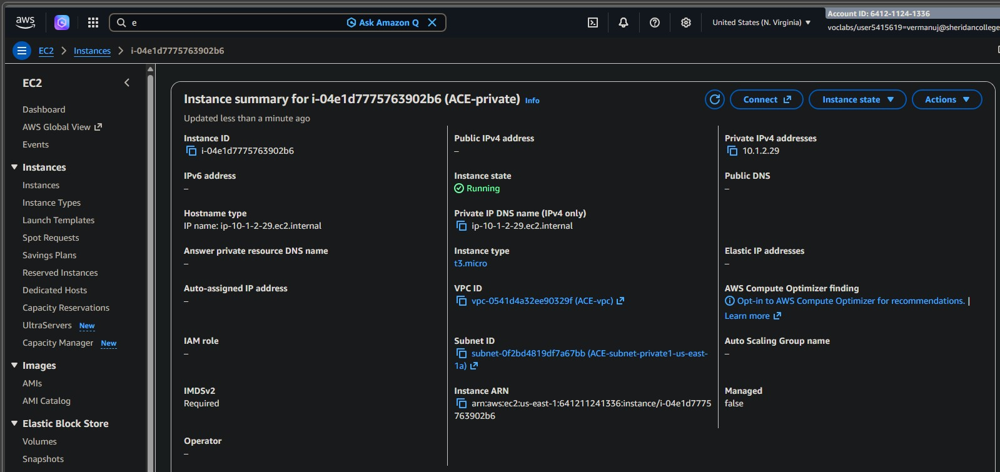

# ACE Cloud Explorer

ACE Cloud Explorer is an AWS-based cloud project designed to demonstrate a secure public/private network architecture and dynamic access to cloud service data stored in Amazon S3.

## Project Overview

The project uses AWS networking and compute services to host a web application inside a custom VPC.

The architecture includes:
- A custom VPC
- Public and private subnets
- EC2 instances
- A bastion host for secure access to the private instance
- Amazon S3 for storing application data
- IAM roles for secure access to S3 without hard-coded credentials

## Technologies Used

- AWS VPC
- Amazon EC2
- Amazon S3
- AWS IAM
- Linux
- Apache
- PHP
- HTML/CSS
- Git and GitHub
## Key Features

- AWS VPC with public and private subnets
- Public EC2 web server hosting the ACE Cloud Explorer application
- Private EC2 instance protected from direct internet access
- Bastion-host access to private infrastructure
- Private Amazon S3 bucket used as the application's data source
- IAM instance profile for S3 access without hard-coded AWS credentials
- Dynamic service information loaded from `services.json`
- Security groups used to control access between resources
## Architecture

The application is deployed inside a custom AWS VPC.

A public EC2 instance is located in the public subnet and can communicate with the internet through an Internet Gateway. A private EC2 instance is isolated from direct internet access.

The public instance also acts as a bastion host, allowing secure SSH access to the private instance.

Application data is stored in a private Amazon S3 bucket. EC2 accesses the bucket using an IAM role attached through an instance profile, avoiding the need to store AWS access keys on the server.

## Architecture Diagram

The diagram below shows the AWS architecture used in ACE Cloud Explorer.



## How the Architecture Works

1. The user accesses the ACE Cloud Explorer web application through the public EC2 instance.
2. The public EC2 instance is hosted inside a public subnet connected to an Internet Gateway.
3. Application data is stored in a private Amazon S3 bucket.
4. The EC2 instance accesses S3 through an IAM role attached to the instance, so AWS access keys do not need to be stored in the application.
5. A private EC2 instance is placed inside the private subnet and cannot be accessed directly from the internet.
6. Administrative access to the private instance is performed through the public EC2 instance acting as a bastion host.

## Project Screenshots

### ACE Cloud Explorer Web Application

The application dynamically displays AWS cloud service information retrieved from Amazon S3.



### Amazon S3 Data Source

Cloud service data is stored in a private S3 bucket and retrieved by the EC2 application using an IAM role.



### Private EC2 Access

The private EC2 instance has no public IP address and is accessed through the public EC2 instance acting as a bastion host.



## Challenges and Troubleshooting

### Accessing the Private EC2 Instance

One challenge during the project was securely accessing the EC2 instance inside the private subnet.

The private instance does not have a public IP address, so it cannot be accessed directly from the internet. The public EC2 instance was used as a bastion host to reach the private instance through its private IP address.

This helped demonstrate how private cloud resources can remain isolated from direct internet access while still allowing controlled administrative access.

### Accessing S3 Without Hard-Coded Credentials

The application needed permission to retrieve the `services.json` file from Amazon S3.

Instead of storing AWS access keys inside the application, an IAM role was attached to the EC2 instance through an instance profile. This allowed the application to access the required S3 object securely using temporary AWS credentials provided by the instance role.
## Setup and Deployment

The ACE Cloud Explorer environment was deployed manually in AWS to understand how the individual cloud services connect together.

### Deployment Steps

1. Create a custom VPC.
2. Create a public subnet and a private subnet.
3. Attach an Internet Gateway to the VPC.
4. Configure the public route table to send internet traffic through the Internet Gateway.
5. Launch the public EC2 instance in the public subnet.
6. Launch the private EC2 instance in the private subnet without a public IP address.
7. Configure security groups to allow only the required traffic.
8. Install Apache and PHP on the public EC2 instance.
9. Upload `services.json` to a private Amazon S3 bucket.
10. Attach an IAM instance profile to the public EC2 instance with permission to access the required S3 object.
11. Deploy the ACE Cloud Explorer application to the web server.
12. Test the web application and verify access to the private instance through the bastion host
## What I Learned

This project helped me understand how multiple AWS services work together as part of a complete cloud architecture.

I gained practical experience with:

- Designing a VPC with public and private subnets.
- Configuring Internet Gateways and route tables.
- Launching and configuring EC2 instances.
- Understanding the difference between public and private cloud resources.
- Using a bastion host to access an EC2 instance that does not have a public IP address.
- Storing application data in Amazon S3.
- Using IAM roles so applications can access AWS services without hard-coded access keys.
- Configuring security groups to control network access.
- Deploying and troubleshooting a web application on a Linux EC2 instance.
- Documenting a cloud architecture using diagrams and screenshots.

One of the most useful lessons from this project was understanding that cloud security is not based on a single service. Network design, IAM permissions, routing, and security groups all work together to control how resources can be accessed.
## Repository Structure

```text
ace-cloud-explorer/
├── app/
│   └── Web application files
├── architecture/
│   └── AWS architecture diagram
├── screenshots/
│   └── Project screenshots
├── README.md
└── .gitignore
## Future Improvements

The current version of ACE Cloud Explorer demonstrates the core AWS architecture and secure access design. Future improvements could include:

- Rebuilding the AWS infrastructure using Terraform or AWS CloudFormation.
- Adding automated deployment using GitHub Actions.
- Adding Amazon CloudWatch monitoring and logging.
- Separating the bastion host and web server into dedicated EC2 instances.
- Improving IAM permissions by applying more restrictive least-privilege policies.
- Adding a NAT Gateway if the private instance requires controlled outbound internet access.
- Expanding the application to display additional AWS service information.